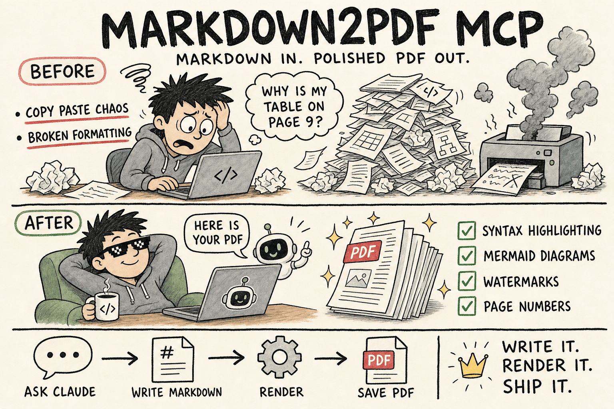
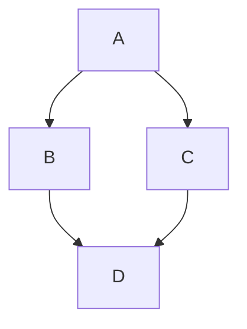

# Markdown2PDF MCP Server (markdown2pdf-mcp)



An MCP server for converting Markdown documents to PDF files. This server provides a simple and efficient way to generate PDFs from Markdown content with support for syntax highlighting, custom styling, optional page numbers, and flexible watermark placement (first page only or all pages).

Inspired by Alan Shaw's [markdown-pdf](https://github.com/alanshaw/markdown-pdf).

## Features

- Convert Markdown to PDF with a single command
- High-performance batch conversions sharing a single browser session (`batch_create_pdf`)
- Pre-flight Markdown validation and linting without launching a browser (`validate_markdown`)
- Built-in visual themes: `default`, `github`, `academic`, `report`, and `minimal`
- Custom CSS styling and font overrides
- Asymmetric margin support (`margin: { top, right, bottom, left }`)
- Convert from string or directly from local file path (`inputPath`)
- Syntax highlighting for code blocks
- Mermaid diagram rendering with local bundle
- Modern PDF generation using Chrome's rendering engine
- Optional page numbers and custom header/footer text
- Watermarks with configurable scope (first page or all pages)

## Limitations

The following markdown elements are not supported:

- LaTeX math equations (e.g., `$x^2$` or `$$\sum_{i=1}^n x_i$$`)
- Complex mathematical formulas or scientific notation

Stick to these supported markdown elements:

- Headers (all levels)
- Text formatting (bold, italic, strikethrough)
- Lists (ordered and unordered)
- Code blocks with syntax highlighting
- Tables
- Blockquotes
- Links
- Images (base64 data URIs, or files in `M2P_ASSETS_DIR`; see [Images](#images))
- Task lists
- Mermaid diagrams

> **Security note:** Rendering is self-contained. Raw HTML in the markdown is not passed through, and the renderer blocks local file reads and outbound requests by default. See the [security advisory](https://github.com/2b3pro/markdown2pdf-mcp/security/advisories/GHSA-r476-vv4c-fhqx).

### Mermaid Diagrams

To render a Mermaid diagram, use a `mermaid` code block:

´´´markdown



´´´

If there is a syntax error in your diagram, the error message will be rendered in the PDF, helping you to debug it. You can also run `validate_markdown` prior to conversion to check Mermaid diagram syntax.

## Installation (from source)

```bash
# Clone the repository
git clone https://github.com/2b3pro/markdown2pdf-mcp.git

# Navigate to the project directory
cd markdown2pdf-mcp

# Install dependencies
npm install

# Build the project
npm run build
```

## Installation (via npm)

```bash
npm install markdown2pdf-mcp
```

## Usage

### MCP Tools Overview

The server provides three focused tools:

1. **`create_pdf_from_markdown`**: Convert a Markdown document to PDF with extensive layout, theme, and margin configuration.
2. **`batch_create_pdf`**: Convert multiple Markdown documents or files in a single call using a shared browser session.
3. **`validate_markdown`**: Fast pre-flight check that validates Markdown syntax, Mermaid blocks, asset paths, and size limits without browser launch overhead.

---

### 1. `create_pdf_from_markdown`

```typescript
{
  // Content inputs (provide at least one)
  markdown?: string;        // Raw Markdown string content
  inputPath?: string;       // Or path to a local .md file on disk

  // Layout & Formatting
  outputFilename?: string;  // Target PDF path (e.g., "report.pdf", "out/q3.pdf")
  paperFormat?: string;     // 'letter' (default), 'a4', 'a3', 'a5', 'legal', 'tabloid'
  paperOrientation?: string;// 'portrait' (default), 'landscape'
  paperBorder?: string;     // Uniform border margin (e.g., '20mm', '1.5in')
  margin?: {                // Asymmetric margins (overrides paperBorder)
    top?: string;
    right?: string;
    bottom?: string;
    left?: string;
  };

  // Themes & Styling
  theme?: string;           // 'default', 'github', 'academic', 'report', 'minimal'
  customCss?: string;       // Custom CSS injected into the page

  // Header, Footer & Watermark
  watermark?: string;       // Watermark text (max 15 characters, uppercase)
  watermarkScope?: string;  // 'all-pages' (default) or 'first-page'
  showPageNumbers?: boolean;// Show page numbers in footer (default: false)
  headerText?: string;      // Custom running header text
  footerText?: string;      // Custom running footer text
}
```

Example with theme and custom margins:

```typescript
await use_mcp_tool({
  server_name: "markdown2pdf",
  tool_name: "create_pdf_from_markdown",
  arguments: {
    markdown: "# Quarterly Report\n\nKey performance highlights...",
    outputFilename: "q3-report.pdf",
    theme: "report",
    paperFormat: "a4",
    margin: { top: "25mm", right: "15mm", bottom: "25mm", left: "15mm" },
    showPageNumbers: true,
    headerText: "Confidential - Executive Eyes Only",
  },
});
```

---

### 2. `batch_create_pdf`

Convert multiple documents in a single call with browser instance reuse:

```typescript
await use_mcp_tool({
  server_name: "markdown2pdf",
  tool_name: "batch_create_pdf",
  arguments: {
    documents: [
      { markdown: "# Chapter 1\nIntroduction...", outputFilename: "ch1.pdf" },
      { inputPath: "docs/ch2.md", outputFilename: "ch2.pdf" },
      { markdown: "# Appendix\nData sheets...", outputFilename: "appendix.pdf", theme: "academic" }
    ],
    sharedConfig: {
      paperFormat: "letter",
      theme: "github",
      showPageNumbers: true
    }
  }
});
```

---

### 3. `validate_markdown`

Fast pre-flight check before initiating PDF conversion:

```typescript
await use_mcp_tool({
  server_name: "markdown2pdf",
  tool_name: "validate_markdown",
  arguments: {
    markdown: "# My Document\nFormula: $x^2$\n```mermaid\ngraph TD; A-->B;\n```"
  }
});
```

Returns document stats, warnings (such as unsupported LaTeX math or stripped HTML tags), and errors (such as broken image references or oversized files).
```

## Running on Demand with `npx`

You can run the server without a permanent local install by asking `npx` to grab the latest package and execute its entrypoint:

```bash
npx -y markdown2pdf-mcp@latest
```

This command installs the package into a temporary workspace and then starts the MCP server via its bundled CLI. Point your MCP-aware client (e.g., Cline or Claude Desktop) to this command to spin up the server on demand.

## Configuration

### Output Directory

You can configure the output directory in your MCP settings file for apps that use MCP such as Cline or Claude. If not configured, it will save files to $HOME:

```json
{
  "mcpServers": {
    "markdown2pdf": {
      "args": ["/path/to/markdown2pdf-mcp/build/index.js"],
      "env": {
        "M2P_OUTPUT_DIR": "/path/to/output/directory"
      }
    }
  }
}
```

`M2P_OUTPUT_DIR` is the default location. A path in `outputFilename` takes precedence: an absolute path is used as-is, and a relative path (e.g., `reports/q3.pdf`) is placed under `M2P_OUTPUT_DIR` (or $HOME if it is not set).

The tool automatically handles file name conflicts by appending incremental numbers (e.g., output.pdf, output-1.pdf, output-2.pdf).

### Images

For security, the renderer does not load images from arbitrary local paths or external URLs. You have three options:

1. **Base64 data URIs** work everywhere with no configuration: ``
2. **An assets directory.** Set `M2P_ASSETS_DIR` and reference images by relative path. Only files that resolve inside that directory load; `../` traversal, symlinks pointing outside it, and absolute paths elsewhere are blocked.

   ```json
   "env": {
     "M2P_ASSETS_DIR": "/path/to/images"
   }
   ```

   ```markdown
   
   ```

3. **Manual override (unsafe).** Start the server with `--dangerously-allow-images` (or set `M2P_DANGEROUSLY_ALLOW_ALL_IMAGES=true`) to load images from any local path or URL, as in versions before 2.2.0. This reopens the file disclosure and SSRF issues described in the advisory, so only use it when every piece of markdown the server receives is fully trusted. Raw HTML stays disabled either way.

   ```json
   "args": ["/path/to/markdown2pdf-mcp/build/index.js", "--dangerously-allow-images"]
   ```

### Large File Support

The tool automatically handles large markdown files with:

- **Dynamic Timeouts**: Automatically scales based on content size (up to 5 minutes for very large files)
- **Memory Limits**: 4GB memory allocation for Chrome to handle complex documents
- **Size Validation**: Maximum 10MB file size with clear error messages
- **Progress Tracking**: Shows content size and estimated processing time

For very large files (1300+ lines), the tool will:
1. Warn you about extended processing time
2. Automatically increase timeouts
3. Display content size in the response
4. Provide detailed error messages if processing fails

### Verbose Logging

Enable detailed logging for debugging:

```json
{
  "mcpServers": {
    "markdown2pdf": {
      "command": "node",
      "args": ["/path/to/markdown2pdf-mcp/build/index.js"],
      "env": {
        "M2P_OUTPUT_DIR": "/path/to/output/directory",
        "M2P_VERBOSE": "true"
      }
    }
  }
}
```

This will log processing steps to stderr without interfering with MCP communication.

> Prefer a locally built version? Swap `"command"` back to `node` and point `"args"` to the compiled `build/index.js` path instead of using `npx`, for example: `"args": ["/path/to/markdown2pdf-mcp/build/index.js"]`.

## Dependencies

- [@modelcontextprotocol/sdk](https://github.com/modelcontextprotocol/sdk) - MCP SDK for server implementation
- [remarkable](https://github.com/jonschlinkert/remarkable) - Markdown parser
- [highlight.js](https://github.com/highlightjs/highlight.js) - Syntax highlighting
- [puppeteer](https://github.com/puppeteer/puppeteer) - Modern PDF generation using [Chrome for Testing](https://developer.chrome.com/blog/chrome-for-testing/) (v131.0.6778.204)

## Chrome Version

This package uses Chrome v131.0.6778.204 for consistent PDF generation across all installations. This version is automatically installed when you run `npm install`.

- [tmp](https://github.com/raszi/node-tmp) - Temporary file handling

## Development

```bash
# Build the project
npm run build

# Start the server
npm start
```

---

## Support

Markdown2PDF MCP is free and open source. If it saves you time turning Markdown into polished PDFs, consider buying me a coffee and croissant! It helps keep the updates coming.

<a href="https://paypal.me/2b3/5"></a>

**[Buy me a cup of coffee and croissant!](https://paypal.me/2b3/10)**

---

## License

MIT

## Contributing

1. Fork the repository
2. Create your feature branch (`git checkout -b feature/amazing-feature`)
3. Commit your changes (`git commit -m 'Add some amazing feature'`)
4. Push to the branch (`git push origin feature/amazing-feature`)
5. Open a Pull Request
